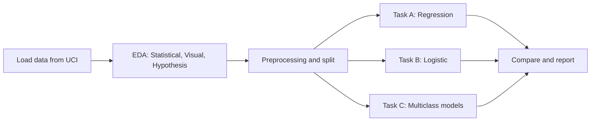

<div align="center">

# 🩺 Obesity Risk Analysis
### End-to-end Machine Learning project on the UCI Obesity dataset

[](https://colab.research.google.com/github/amitrider1289-netizen/Agile_AI_DS/blob/Amit/Obesity_Risk_Analysis.ipynb)


**👉 Click the "Open In Colab" badge to run the whole project in your browser. No download or setup needed.**

</div>

---

## 📑 Table of Contents
- [Overview](#-overview)
- [Dataset](#-dataset)
- [Project Workflow](#-project-workflow)
- [Quick Start](#-quick-start)
- [EDA Findings](#-eda-findings)
- [Models and Results](#-models-and-results)
- [Key Insights](#-key-insights)
- [Concepts from Lab Experiments](#-concepts-from-lab-experiments)
- [Repository Structure](#-repository-structure)
- [Author](#-author)

---

## 🎯 Overview
This project combines the techniques from our Machine Learning lab (Exp 1 to 8) on **one real-world dataset**. It predicts a person's **weight** (regression) and **obesity level** (classification) from eating habits and physical condition.

| Task | Type | Target | Models |
|---|---|---|---|
| **A** | Regression | `Weight` | Linear, Ridge, Lasso, Elastic Net |
| **B** | Binary classification | Obese vs not | Logistic Regression |
| **C** | Multiclass classification | `NObeyesdad` (7 classes) | Logistic, Decision Tree, Random Forest, Gradient Boosting, XGBoost, LightGBM, KNN, SVM |

---

## 📦 Dataset
**Estimation of Obesity Levels Based on Eating Habits and Physical Condition**
- Source: [UCI Machine Learning Repository (id 544)](https://archive.ics.uci.edu/dataset/544)
- Size: 2,111 rows, 16 features, 7 target classes
- Loaded **directly into memory** with the `ucimlrepo` package, so nothing is downloaded to disk.

```python
from ucimlrepo import fetch_ucirepo
d = fetch_ucirepo(id=544)
```

<details>
<summary><b>📖 Feature dictionary (click to expand)</b></summary>

| Column | Meaning |
|---|---|
| Gender, Age, Height, Weight | Basic demographics |
| family_history_with_overweight | Family history of overweight |
| FAVC | Frequent high-calorie food |
| FCVC | Vegetable consumption frequency |
| NCP | Number of main meals |
| CAEC | Snacking between meals |
| SMOKE | Smoker or not |
| CH2O | Daily water intake |
| SCC | Calorie monitoring |
| FAF | Physical activity frequency |
| TUE | Time using technology devices |
| CALC | Alcohol consumption |
| MTRANS | Transportation used |
| NObeyesdad | **Target**: obesity level |

</details>

---

## 🔄 Project Workflow


---

## 🚀 Quick Start

**Option 1: Google Colab (recommended)**
Click the **Open In Colab** badge at the top.

**Option 2: Run locally**
```bash
git clone -b Amit https://github.com/amitrider1289-netizen/Agile_AI_DS.git
cd Agile_AI_DS
pip install -r requirements.txt
jupyter notebook Obesity_Risk_Analysis.ipynb
```

---

## 🔍 EDA Findings

<details>
<summary><b>1️⃣ Statistical EDA</b></summary>

- Skewness and kurtosis: *(add your findings, e.g. Age is right-skewed)*
- Normality (D'Agostino test): *(most features are not normal, so non-parametric tests were used)*
- Outliers (IQR and Z-score): *(add counts, e.g. Age has N outliers)*

</details>

<details>
<summary><b>2️⃣ Visual EDA</b></summary>

- Class distribution is nearly balanced
- Weight and BMI separate the classes strongly
- *(add your observations)*

</details>

<details>
<summary><b>3️⃣ Hypothesis testing</b></summary>

| Hypothesis | Test | p-value | Decision |
|---|---|---|---|
| H1: FAF differs across classes | Kruskal-Wallis | | |
| H2: Obese exercise less | Mann-Whitney | | |
| H3: Family history ↔ obesity | Chi-square | | |
| H4: High-calorie food ↔ obesity | Chi-square | | |
| H5: Snacking ↔ obesity | Chi-square | | |
| H6: Transport ↔ obesity | Chi-square | | |
| H7: Obese are older | Mann-Whitney | | |
| H8: Weight ~ FAF | Spearman | | |

Significance level α = 0.05 with Bonferroni correction.

</details>

---

## 📊 Models and Results

<details open>
<summary><b>Task A: Regression (predict Weight)</b></summary>

| Model | MAE | MSE | RMSE | R² |
|---|---|---|---|---|
| Linear | | | | |
| Ridge | | | | |
| Lasso | | | | |
| Elastic Net | | | | |

</details>

<details open>
<summary><b>Task C: Multiclass classification</b></summary>

| Model | Accuracy | Precision | Recall | F1 |
|---|---|---|---|---|
| Logistic Regression | | | | |
| Decision Tree | | | | |
| Random Forest | | | | |
| Gradient Boosting | | | | |
| XGBoost | | | | |
| LightGBM | | | | |
| KNN | | | | |
| SVM | | | | |

🏆 **Best model:** *(fill in)*

</details>

---

## 💡 Key Insights
1. *(Which habits relate most to obesity)*
2. *(Did Lasso drop any features)*
3. *(Best classifier and why)*

> ⚠️ **Data leakage note:** The obesity labels are derived from BMI. `Height` and `Weight` were therefore **removed** from the classification task so the models learn from habits, not from the formula.

---

## 🧪 Concepts from Lab Experiments

| Exp | Concept | Used here |
|---|---|---|
| 1 | EDA | ✅ Statistical, visual, hypothesis-driven |
| 2 | Linear Regression | ✅ Task A |
| 3 | Logistic Regression | ✅ Task B and C |
| 4 | Ridge, Lasso, Elastic Net | ✅ Task A |
| 5 | Decision Tree | ✅ Task C |
| 6 | Random Forest | ✅ Task C, feature importance |
| 7 | Boosting (GB, XGBoost, LightGBM) | ✅ Task C |
| 8 | KNN and SVM | ✅ Task C |

---

## 📁 Repository Structure
```
├── Obesity_Risk_Analysis.ipynb   # Main notebook
├── requirements.txt              # Dependencies
└── README.md
```

---

## 👤 Author
**Amit Goyal**
Enroll No: A357192625011 | Course: CSE(AI&DS)
[GitHub](https://github.com/amitrider1289-netizen) · [LinkedIn](https://www.linkedin.com/in/amit-goyal-bb1080386)

⭐ If you found this useful, give the repo a star!
