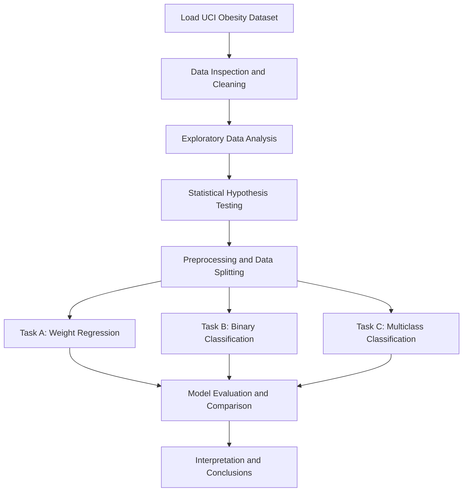
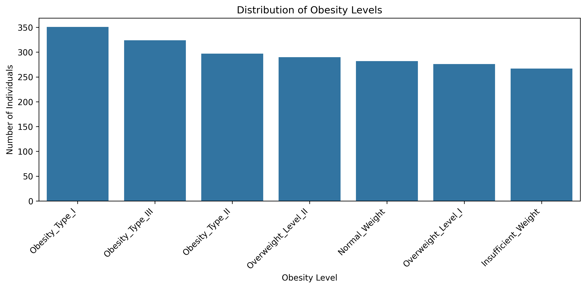
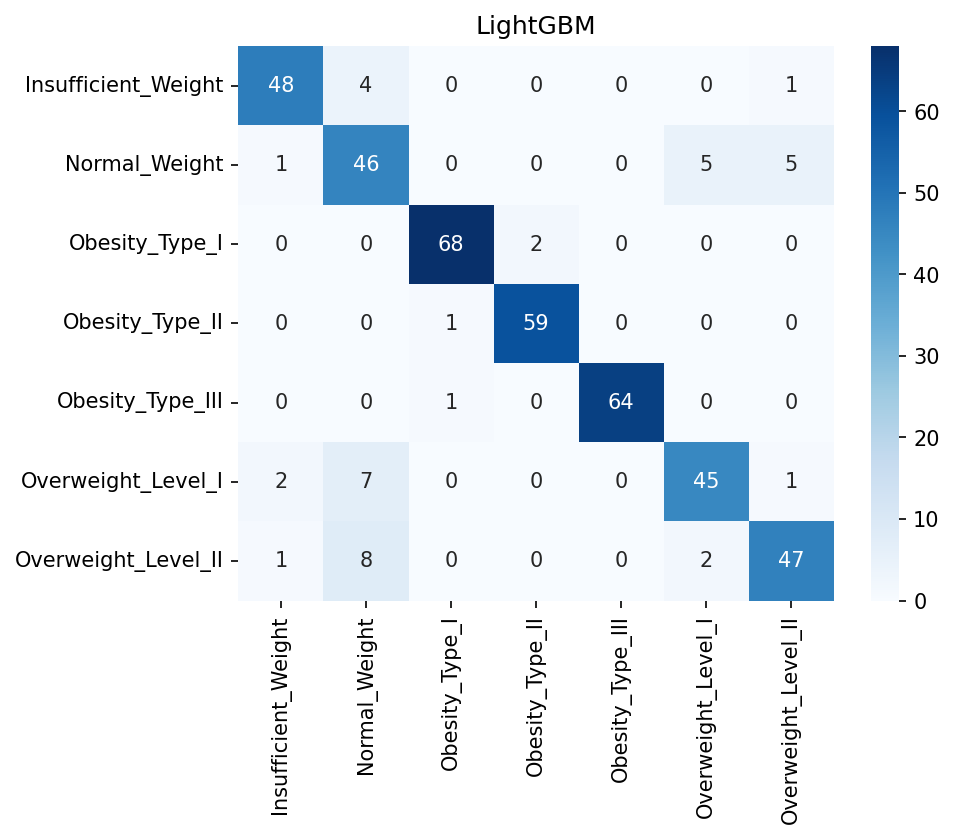
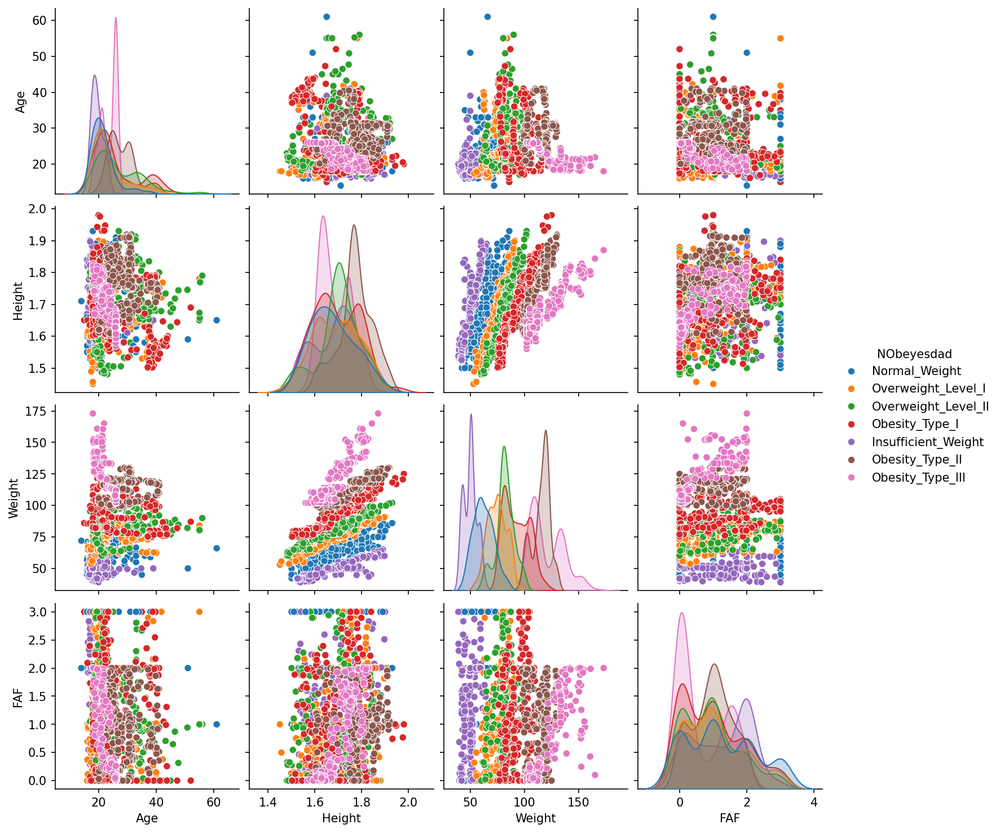

<div align="center">

# 🩺 Obesity Risk Analysis
### An End-to-End Machine Learning Project on the UCI Obesity Dataset

[](https://colab.research.google.com/github/amitrider1289-netizen/Agile_AI_DS/blob/Amit/Obesity_Risk_Analysis.ipynb)


**Predicting obesity levels and exploring the relationship between lifestyle habits, physical condition, and body weight.**

👉 Click the **Open In Colab** badge to open the notebook in Google Colab. You may need to save a copy to your Google Drive to execute and modify it.

</div>

---

## 📑 Table of Contents
- [Overview](#-overview)
- [Dataset](#-dataset)
- [Project Workflow](#-project-workflow)
- [Quick Start](#-quick-start)
- [Exploratory Data Analysis](#-exploratory-data-analysis)
- [Correlation and Multicollinearity Analysis](#-correlation-and-multicollinearity-analysis)
- [Models and Results](#-models-and-results)
- [Key Insights](#-key-insights)
- [Concepts from Lab Experiments](#-concepts-from-lab-experiments)
- [Repository Structure](#-repository-structure)
- [Limitations](#-limitations)
- [Author](#-author)

---

## 🎯 Overview
Obesity is influenced by multiple factors, including eating habits, physical activity, family history, and other lifestyle characteristics. This project applies exploratory data analysis, statistical hypothesis testing, and machine learning to investigate these factors using the UCI Obesity dataset.

The project integrates concepts from Machine Learning Lab Experiments 1–8 into a single dataset-based workflow.

### Project Objectives
- Explore the dataset using statistical summaries and visualizations.
- Investigate associations between lifestyle characteristics and obesity levels.
- Predict body weight using regression algorithms.
- Classify obesity-related outcomes using binary and multiclass classification.
- Compare machine learning algorithms using appropriate evaluation metrics.
- Examine feature correlations and multicollinearity.

### Machine Learning Tasks

| Task | Type | Target | Algorithms |
|---|---|---|---|
| **A** | Regression | `Weight` | Linear Regression, Ridge, Lasso, Elastic Net |
| **B** | Binary classification | Obese vs. not obese | Logistic Regression |
| **C** | Multiclass classification | `NObeyesdad` | Logistic Regression, Decision Tree, Random Forest, Gradient Boosting, XGBoost, LightGBM, KNN, SVM |

**🏆 Headline results:** LightGBM achieved 90.2% accuracy and a weighted F1-score of 0.903 in multiclass classification. Lasso Regression achieved an R² score of 0.816 in the weight-prediction task.

---

## 📦 Dataset
**Dataset:** Estimation of Obesity Levels Based on Eating Habits and Physical Condition

- **Source:** [UCI Machine Learning Repository — Dataset 544](https://archive.ics.uci.edu/dataset/544)
- **Original dataset size:** 2,111 observations
- **Input features:** 16
- **Classification target:** `NObeyesdad`
- **Target classes:** 7 obesity-level categories
- **Loading method:** `ucimlrepo`

The dataset contains demographic information, eating habits, physical activity, and other lifestyle characteristics.

### Loading the Dataset
```python
from ucimlrepo import fetch_ucirepo

obesity_data = fetch_ucirepo(id=544)

X = obesity_data.data.features
y = obesity_data.data.targets
```

The dataset is retrieved through the UCI repository interface. This code does not explicitly save a local dataset file.

<details>
<summary><b>📋 Feature Dictionary (click to expand)</b></summary>

| Feature | Meaning |
|---|---|
| `Gender` | Gender category recorded in the dataset |
| `Age` | Age of the individual |
| `Height` | Height |
| `Weight` | Body weight |
| `family_history_with_overweight` | Family history of overweight |
| `FAVC` | Frequent consumption of high-calorie food |
| `FCVC` | Frequency of vegetable consumption |
| `NCP` | Number of main meals |
| `CAEC` | Consumption of food between meals |
| `SMOKE` | Smoking status |
| `CH2O` | Daily water-consumption measure |
| `SCC` | Calorie-consumption monitoring |
| `FAF` | Physical activity frequency |
| `TUE` | Time using technological devices |
| `CALC` | Alcohol-consumption frequency |
| `MTRANS` | Main mode of transportation |
| `NObeyesdad` | **Target variable:** obesity-level classification |

</details>

> **Note:** Several lifestyle variables are categorical or ordinal. Their numeric representations should not automatically be interpreted as continuous measurements.

---

## 🔄 Project Workflow


---

## 🚀 Quick Start

**Option 1: Google Colab**
1. Click the **Open In Colab** badge at the top.
2. Open the notebook in Google Colab.
3. Save a copy to your Google Drive if you want to edit it.
4. Install any missing dependencies if prompted.
5. Execute the notebook cells in order.

**Option 2: Run Locally**

Clone the project repository:
```bash
git clone -b Amit https://github.com/amitrider1289-netizen/Agile_AI_DS.git
cd Agile_AI_DS
pip install -r requirements.txt
jupyter notebook Obesity_Risk_Analysis.ipynb
```

Python 3.10 or later is the intended environment. Package versions and compatibility should be checked if the notebook is run in a different environment.

---

## 🔍 Exploratory Data Analysis
Exploratory Data Analysis (EDA) helps understand the dataset, identify patterns, examine feature distributions, and investigate relationships before interpreting machine learning results.

<details open>
<summary><b>1️⃣ Statistical EDA</b></summary>

The notebook examines numerical features using descriptive statistics, skewness, kurtosis, and the D'Agostino normality test.

| Feature | Skewness | Kurtosis | Normality result |
|---|---:|---:|---|
| Age | 1.51 | 2.77 | Not normal |
| Height | -0.02 | -0.56 | Not normal |
| Weight | 0.24 | -0.71 | Not normal |
| FCVC | -0.45 | -0.62 | Not normal |
| NCP | -1.14 | 0.53 | Not normal |
| CH2O | -0.11 | -0.86 | Not normal |
| FAF | 0.49 | -0.64 | Not normal |
| TUE | 0.61 | -0.55 | Not normal |

**Key observations:**
- **Age:** Positive skewness indicates a longer tail toward higher ages.
- **NCP:** Negative skewness indicates a longer tail toward lower values.
- **Normality:** The reported tests rejected normality for all eight listed features.

The normality results informed the choice of statistical tests. However, the choice of test also depends on the research question, data structure, and test assumptions.

</details>

<details open>
<summary><b>2️⃣ Visual EDA</b></summary>

The visual analysis investigates obesity-category distribution, feature relationships, and potential patterns in the data.

**Target Distribution**



*Figure 1: Distribution of observations across the obesity-level categories.*

This plot helps identify the representation of each target category and whether some categories contain more observations than others.

**Correlation Heatmap**



*Figure 2: Correlations between numerical or appropriately encoded features.*

The heatmap helps identify relationships between features. Correlation does not establish causation, and correlations involving encoded categorical variables require careful interpretation.

**Pair Plot**



*Figure 3: Pairwise relationships and distributions of selected features.*

The pair plot helps examine relationships between selected numerical features and identify possible patterns or overlapping distributions.

**Key observations from the visual analysis:**
- Body weight separates obesity categories strongly, which is expected because the obesity-level labels are related to BMI.
- Lifestyle variables such as physical activity, vegetable consumption, and water consumption show overlapping distributions across classes.
- The dataset contains multiple obesity categories, allowing a comparison of multiclass classification algorithms.

Visual separation alone does not establish causation or prove that a feature independently predicts obesity.

</details>

<details open>
<summary><b>3️⃣ Statistical Hypothesis Testing</b></summary>

The notebook uses non-parametric and categorical association tests to investigate selected hypotheses.

| Hypothesis | Statistical test | Reported p-value | Effect size | Decision |
|---|---|---|---|---|
| H1: Physical activity differs across obesity classes | Kruskal–Wallis | < 0.0001 | Not reported | ✅ Reject H₀ |
| H2: Obese individuals exercise less | One-sided Mann–Whitney U | < 0.0001 | Not reported | ✅ Reject H₀ |
| H3: Family history is associated with obesity class | Chi-square | < 0.0001 | Cramér's V = 0.41 | ✅ Reject H₀ |
| H4: High-calorie food consumption is associated with obesity class | Chi-square | < 0.0001 | Cramér's V = 0.28 | ✅ Reject H₀ |
| H5: Snacking frequency is associated with obesity class | Chi-square | < 0.0001 | Cramér's V = 0.36 | ✅ Reject H₀ |
| H6: Transportation mode is associated with obesity class | Chi-square | < 0.0001 | Cramér's V = 0.15 | ✅ Reject H₀ |
| H7: Obese individuals are older | One-sided Mann–Whitney U | < 0.0001 | Not reported | ✅ Reject H₀ |
| H8: Weight and physical activity have a monotonic association | Spearman correlation | 0.0244 | ρ = -0.05 | ❌ Not significant after correction |

The notebook reports a significance level of α = 0.05 with Bonferroni-adjusted α = 0.00625 for eight tests.

The H8 p-value is below 0.05 but above the adjusted significance threshold. Therefore, it does not meet the corrected significance criterion. Its reported correlation of -0.05 is also negligible in magnitude.

**Interpretation:** Family history and snacking frequency show relatively stronger categorical associations among the variables examined. These are associations, not proof that the variables cause obesity.

</details>

---

## 🔗 Correlation and Multicollinearity Analysis
Correlation analysis and Variance Inflation Factor (VIF) were used to examine relationships and potential redundancy among predictors.

<details open>
<summary><b>1️⃣ Correlation Analysis</b></summary>

The notebook calculates absolute Pearson correlations between encoded features and identifies pairs exceeding 0.7.

The diagnostic output initially displayed positive values for two pairs of mutually exclusive dummy variables. After checking the encoded columns, cross-tabulations, and recalculating the correlation matrix, the following values were obtained:

| Feature pair | Correlation |
|---|---:|
| `CALC_Sometimes` and `CALC_no` | -0.924964 |
| `CAEC_Frequently` and `CAEC_Sometimes` | -0.829896 |

The overlap checks found zero observations in which both indicators were `True` for either pair.

These negative correlations are consistent with the mutually exclusive nature of the categories. The earlier positive values were inconsistent with the verified cross-tabulations; their precise cause has not been established.

</details>

<details open>
<summary><b>2️⃣ VIF Analysis</b></summary>

The reported VIF values were:

| Feature | VIF |
|---|---:|
| `CALC_Sometimes` | 482.55 |
| `CALC_no` | 455.72 |
| `CALC_Frequently` | 70.60 |
| `CAEC_Sometimes` | 5.59 |
| `CAEC_Frequently` | 4.96 |
| `Height` | 2.22 |
| `Age` | 1.98 |
| `MTRANS_Public_Transportation` | 1.96 |
| `Gender_Male` | 1.94 |
| `CAEC_no` | 1.74 |
| `Obese` | 1.53 |
| `family_history_with_overweight_yes` | 1.39 |
| `MTRANS_Walking` | 1.25 |
| `FAF` | 1.25 |
| `FAVC_yes` | 1.23 |
| `FCVC` | 1.19 |
| `TUE` | 1.18 |
| `CH2O` | 1.15 |
| `SCC_yes` | 1.12 |
| `NCP` | 1.11 |
| `MTRANS_Motorbike` | 1.05 |
| `SMOKE_yes` | 1.04 |
| `MTRANS_Bike` | 1.03 |

The high VIF values for the `CALC` indicators warrant caution. VIF measures how strongly a predictor can be explained by the other predictors in the matrix. Redundant categorical encoding and the handling of the intercept can affect its values.

The VIF figures alone do not establish the exact cause of the high values. They are reported as diagnostic findings rather than proof of an encoding error.

</details>

---

## 📊 Models and Results

<details open>
<summary><b>Task A: Regression — Predicting Weight</b></summary>

Four regression algorithms were evaluated using MAE, MSE, RMSE, and R².

| Model | MAE | MSE | RMSE | R² |
|---|---:|---:|---:|---:|
| Linear Regression | 8.825 | 131.299 | 11.459 | 0.814 |
| Ridge Regression | 8.823 | 131.268 | 11.457 | 0.814 |
| **Lasso Regression** | 8.788 | **130.076** | **11.405** | **0.816** |
| Elastic Net | **8.748** | 130.388 | 11.419 | 0.815 |

**Best overall by reported RMSE and R²:** Lasso Regression.

Regularization produced only a small improvement over ordinary Linear Regression. Elastic Net achieved the lowest MAE, so the best model depends on the evaluation metric selected.

</details>

<details open>
<summary><b>Task B: Binary Classification — Obese vs. Not Obese</b></summary>

Logistic Regression was used for the binary classification task.

The objective is to distinguish the defined obese category from the remaining category or categories using the notebook's binary target construction.

The binary classification results are not included here because no verified numerical results for Task B were provided in the project summary.

</details>

<details open>
<summary><b>Task C: Multiclass Classification — Seven Obesity Levels</b></summary>

The following models were compared using accuracy, precision, recall, and F1-score.

| Rank | Model | Accuracy | Precision | Recall | F1-score |
|---:|---|---:|---:|---:|---:|
| 🥇 1 | **LightGBM** | **0.902** | **0.905** | **0.902** | **0.903** |
| 🥈 2 | Random Forest | 0.900 | 0.902 | 0.900 | 0.900 |
| 🥉 3 | XGBoost | 0.892 | 0.893 | 0.892 | 0.893 |
| 4 | Gradient Boosting | 0.880 | 0.881 | 0.880 | 0.881 |
| 5 | SVM | 0.830 | 0.841 | 0.830 | 0.833 |
| 6 | KNN | 0.821 | 0.821 | 0.821 | 0.818 |
| 7 | Logistic Regression | 0.787 | 0.787 | 0.787 | 0.784 |
| 8 | Decision Tree | 0.746 | 0.759 | 0.746 | 0.749 |

🏆 **Best classifier by reported results:** LightGBM
- Accuracy: 90.2%
- Weighted precision: 90.5%
- Weighted recall: 90.2%
- Weighted F1-score: 90.3%

The results suggest that the tested tree-ensemble models capture useful patterns in this dataset. The observed differences do not, by themselves, establish why one algorithm performs better than another.

</details>

> ⚠️ **Data Leakage Consideration**
>
> Obesity-level labels are related to BMI, which is calculated from body weight and height. Including `Weight` and `Height` in the classification predictors could allow a model to recover information closely related to the target rather than learn from lifestyle characteristics.
>
> Accordingly, both features were excluded from the reported classification task, as described in the project analysis. This makes the classification task more focused on the remaining characteristics, although it does not eliminate every possible source of leakage or bias.

---

## 💡 Key Insights
1. **Lifestyle associations:** Family history and snacking frequency had relatively stronger reported categorical associations among the examined variables.
2. **Regression performance:** Lasso achieved an R² of 0.816, compared with 0.814 for Linear Regression.
3. **Ensemble models:** LightGBM, Random Forest, and XGBoost achieved accuracy scores of approximately 89–90% in the reported multiclass evaluation.
4. **Decision Tree comparison:** The standalone Decision Tree achieved 74.6% accuracy, compared with 90.2% for LightGBM.
5. **Correlation vs. VIF:** Correlation measures the relationship between two features, whereas VIF measures how well one predictor can be explained by the other predictors.
6. **Statistical significance:** Hypothesis tests identify associations within the dataset; they do not establish causal relationships.

---

## 🧪 Concepts from Lab Experiments

| Experiment | Concept | Application |
|---:|---|---|
| 1 | Exploratory Data Analysis | Descriptive statistics, visualizations, hypothesis testing |
| 2 | Linear Regression | Weight prediction |
| 3 | Logistic Regression | Binary and multiclass classification |
| 4 | Ridge, Lasso, Elastic Net | Regularized regression |
| 5 | Decision Tree | Multiclass classification |
| 6 | Random Forest | Ensemble classification |
| 7 | Gradient Boosting, XGBoost, LightGBM | Boosting-based classification |
| 8 | KNN and SVM | Comparative classification |

The purpose of combining these experiments is to understand when different algorithms are useful, how they are evaluated, and how their results can be compared on the same dataset.

---

## 📁 Repository Structure
```
Agile_AI_DS/
├── Obesity_Risk_Analysis.ipynb
├── README.md
├── requirements.txt
├── app.py
├── target_dist.png
├── corr.png
├── pairplot.png
├── bar (1).png
├── box.png
├── cluster (1).png
├── corr (1).png
├── countplot (1).png
├── gofplot.png
├── heatmap (1).png
├── hist (1).png
├── kde (1).png
├── scatterplot.png
├── stackedplot.png
└── violin.png
```

The structure lists the notebook, documentation, application, dependencies, and supporting visualization files. Keep only entries corresponding to files that actually exist in the repository.

The three featured EDA images are embedded directly from the repository root, so a separate `images/` folder is not required.

---

## 🚧 Limitations
- The dataset contains a finite set of observations and may not represent every population.
- Predictive performance on this dataset does not guarantee the same performance on new populations.
- Lifestyle associations do not establish causal effects.
- High VIF values require careful interpretation and do not independently prove an encoding error.
- The reported evaluation scores depend on the notebook's preprocessing, data split, and evaluation methodology.
- This project is an educational machine learning analysis, not a clinical diagnostic or medical decision-making system.

---

## 👤 Author
**Amit Goyal**

- **Course:** CSE (Artificial Intelligence & Data Science)
- **Enrolment Number:** A357192625011
- **GitHub:** [amitrider1289-netizen](https://github.com/amitrider1289-netizen)
- **LinkedIn:** [Amit Goyal](https://www.linkedin.com/in/amit-goyal-bb1080386/)

---

⭐ If you find this project useful, consider giving the repository a star.
